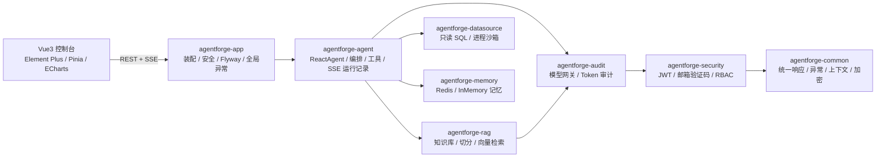

# AgentForge

> 开源企业级多智能体应用平台 · Open-source Enterprise Multi-Agent Platform
>
> **Agent runtime + RAG + enterprise data + secure sandbox + memory + token audit + RBAC**，基于 Spring AI Alibaba / Spring Boot 3.5 / Java 21 / Vue 3。

[](https://openjdk.org/projects/jdk/21/)
[](https://spring.io/projects/spring-boot)
[](https://java2ai.com/)
[](https://vuejs.org/)
[](LICENSE)
[](https://github.com/O-pei/team-agent-forge/actions/workflows/backend-ci.yml)

> 状态：**v0.1.0 已发布** —— 认证/RBAC、模型网关、Token 审计、记忆引擎、RAG、数据源直连、进程沙箱、多智能体 Harness（SSE）、Vue3 控制台均可端到端运行；无模型 Key / 无 Redis / 无 Docker 时自动降级，零外部依赖即可启动。
> 规划与边界见 [`docs/02-开发路线图.md`](docs/02-开发路线图.md)，能力现状见下方[能力矩阵](#能力矩阵v010)。

---

## 为什么是 AgentForge

企业落地 Agent 的难点不在「调用一次大模型」，而在**把它变成可治理的生产系统**：权限、审计、成本、记忆、知识、数据、安全执行、可观测、可扩展。

AgentForge 把这些能力收敛成一套**模块化单体**（可按模块拆服务），让二次开发者直接站在运行时之上做业务：



## 能力矩阵（v0.1.0）

| 能力 | v0.1.0 状态 | 说明 |
| --- | --- | --- |
| 🤖 多智能体协作 | ✅ 已实现 | `ReactAgent`；SINGLE / SEQUENTIAL / PARALLEL 编排可用；SUPERVISOR 当前用 `LlmRoutingAgent` 近似（v0.2 换 Graph 循环） |
| 🧩 Harness 运行时 | ✅ 已实现 | Agent 定义 CRUD、运行记录与步骤（`agent_run` / `agent_run_step`）、工具中心、取消运行、SSE 流式协议 |
| 🔐 认证与 RBAC | ✅ 已实现 | 邮箱验证码注册/登录、JWT 双 Token（access 2h / refresh 7d 轮换）、注销黑名单、登录失败锁定、用户/角色/权限管理、登录日志；短信登录 **预留扩展点**（返回 50300） |
| 📚 RAG 知识增强 | ✅ 已实现 | Tika 解析 → 512/64 切分 → `HashingEmbeddingModel`（1024 维、离线确定性）→ `SimpleVectorStore`（JSON 持久化）→ topK/threshold 检索；文档状态机与重建索引 |
| 🔌 数据源直连 | ✅ 已实现 | MySQL/PostgreSQL 注册、连接测试、Schema 采集、只读 SQL（JSqlParser 校验、自动 LIMIT、超时、查询日志）；密码 AES-GCM 加密 |
| 🛡️ 安全沙箱执行 | ✅ 已实现 | Process 沙箱：Java / Python / Node / Shell，超时杀进程树、输出截断、环境变量白名单；**无网络/文件系统隔离**，生产请等 v0.2 的 Docker/gVisor |
| 🧠 记忆引擎 | ✅ 已实现 | 会话消息 + 长期事实记忆；Redis 可用时持久化，否则自动降级 `InMemoryMemoryStore` |
| 🪙 Token 审计 | ✅ 已实现 | 流式/非流式 usage 采集（流式取最后 chunk，缺失按 chars/4 估算）、按模型/Agent/会话汇总、趋势、明细、CSV 导出、概览 |
| 🖥️ 控制台 | ✅ 已实现 | 登录注册、对话（SSE）、Agent、知识库、数据源、沙箱、审计看板、模型配置、用户/角色管理 |
| 🧪 质量保障 | ✅ 已实现 | 106 个单元/集成测试、Node 端到端冒烟脚本、GitHub Actions（后端 verify + 前端 build） |
| 🐳 Docker 沙箱 / pgvector / MCP 管理 / 数据权限 / 配额 | 🚧 v0.2 | 见路线图 |

## 技术栈

- **后端**：Java 21 · Spring Boot 3.5.16 · Spring AI Alibaba 1.1.2.4 · Spring AI 1.1.2 · Spring Security 6 · JPA · Flyway · H2（dev）/ MySQL 8（prod）· Redis（可选）
- **前端**：Vue 3.5 · TypeScript · Vite · Element Plus · Pinia · ECharts
- **工程**：Maven 多模块 · pnpm · GitHub Actions · Apache-2.0

## 快速开始

> 需要 JDK 21、Maven 3.9+、Node 20+（pnpm 10+）；**Redis / MySQL / 模型 Key 全部可选**。

```bash
# 1. 后端（dev profile：H2 文件库 + Mock 模型，零外部依赖）
mvn -DskipTests install
java -jar agentforge-app/target/agentforge-app-0.1.0-SNAPSHOT.jar

# 2. 前端（另开终端）
cd agentforge-ui && pnpm install && pnpm dev
```

- 控制台：http://localhost:5173
- 后端 API：http://localhost:8080/api/v1
- Swagger：http://localhost:8080/swagger-ui.html
- 健康检查：http://localhost:8080/actuator/health
- 默认管理员：`admin@agentforge.dev` / `Admin@123456`（仅 dev 自动创建，生产用 `AGENTFORGE_SEED_ADMIN=false` 关闭）

接入真实 DashScope 模型：**登录控制台 →「模型配置」→ 新建 provider=`DASHSCOPE`、填 `modelName`（如 `qwen-plus`）与 `apiKey` → 设为默认**。API Key 会用 AES-GCM 加密入库（`AGENTFORGE_CRYPTO_KEY` 配置主密钥），不会回显。

> `AI_DASHSCOPE_API_KEY` 环境变量只用于满足 Spring AI Alibaba 自动配置的启动校验（内置占位），**不会**自动替换模型网关里的 Key；生产请两者都配置并替换 `AGENTFORGE_CRYPTO_KEY`。

端到端冒烟（后端已启动、Node 18+）：

```bash
node scripts/smoke-test.mjs --base-url http://127.0.0.1:8080
```

## 模块结构

```
agentforge-parent
├── agentforge-common      统一响应/异常/上下文/加密/JPA 基类 + 跨模块 SPI
├── agentforge-security    账号、邮箱验证、JWT、RBAC、登录日志
├── agentforge-audit       模型网关（MOCK/DASHSCOPE/OpenAI 兼容）、Token 计量与审计
├── agentforge-memory      Redis / InMemory 记忆引擎、长期事实召回
├── agentforge-rag         知识库、文档流水线、Hashing Embedding、向量检索
├── agentforge-datasource  数据源注册、只读 SQL 守卫、Process 沙箱
├── agentforge-agent       Harness 运行时、工具中心、多智能体编排、SSE
├── agentforge-app         启动与装配、安全配置、Flyway、全局异常
└── agentforge-ui          Vue3 控制台
```

依赖方向只允许向下：`app → agent → {memory, rag, datasource} → audit → security → common`。

## 文档

| 文档 | 内容 |
| --- | --- |
| [技术方案](docs/01-技术方案.md) | 架构、选型、数据模型、API 规范、安全设计 |
| [开发路线图](docs/02-开发路线图.md) | 阶段任务、里程碑、验收标准、v0.1/v0.2 边界 |
| [本地开发环境](docs/03-本地开发环境.md) | 5 分钟启动、MySQL/Redis/模型/邮件配置、FAQ |
| [API 契约](docs/04-API契约.md) | 冻结的 REST/SSE 协议、错误码、权限码、Flyway 编号 |
| [认证与权限设计](docs/05-认证与权限设计.md) | JWT、验证码、RBAC、扩展点 |
| [模型网关与审计与记忆](docs/06-模型网关与审计与记忆.md) | 模型包装链、usage 采集、记忆降级 |
| [RAG 与数据源与沙箱](docs/07-RAG与数据源与沙箱.md) | 检索管线、SQL 安全、沙箱边界 |
| [前端开发指南](docs/08-前端开发指南.md) | 请求层、SSE、页面与权限映射 |
| [多智能体 Harness](docs/09-多智能体Harness设计.md) | ReactAgent 工厂、编排、工具、SSE 事件 |
| [AGENTS.md](AGENTS.md) | 面向 AI 协作者的开发约定 |
| [研究笔记](docs/research/SAA-1.1.2-API.md) | Spring AI Alibaba 1.1.2.x API 实测 |

## 已知限制（v0.1.0）

- **沙箱隔离**：Process 沙箱只做超时/输出/环境变量约束，不隔离网络与文件系统；不可执行不可信代码，生产需 Docker/gVisor（v0.2）。
- **向量检索**：默认 `HashingEmbeddingModel` 是离线确定性哈希向量，召回质量低于真实 embedding；`SimpleVectorStore` 为单机 JSON 持久化。
- **记忆**：Redis 的 checkpointer（`RedisSaver`）尚未作为默认开启；无 Redis 时为进程内记忆。
- **编排**：SUPERVISOR 用 `LlmRoutingAgent` 近似（单次路由），并行编排的 merge 策略较简单。
- **计费**：`ai_model_price` 表已就位，成本聚合的定价算法在 v0.2 完善。
- **多租户**：表结构含 `tenant_id` 基础字段，租户隔离/数据权限未做完整强制。
- **MCP**：依赖与客户端配置已具备，MCP Server 管理台/网关在 v0.2。

## 参与贡献

见 [`CONTRIBUTING.md`](CONTRIBUTING.md)；安全问题请按 [`SECURITY.md`](SECURITY.md) 上报。欢迎 Issue / PR / Star ⭐

## License

[Apache License 2.0](LICENSE)
