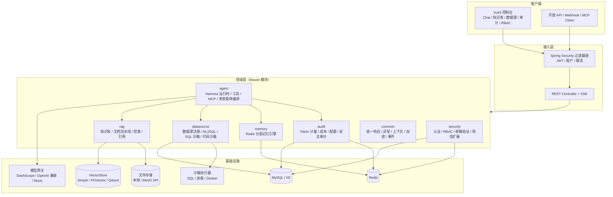

# AgentForge 技术方案（v1.0 定稿）

> 面向开源的企业级多智能体应用平台。本文是项目的架构与选型基线：所有模块拆分、接口约定、阶段任务均以本文为准。
>
> 状态：**已定稿**（待产品负责人确认 3 个开放项：仓库名/许可、模型 API Key、主数据库）
> 最后更新：2026-10-29
> 配套： [`02-开发路线图.md`](./02-开发路线图.md) · SAA API 调研 [`research/SAA-1.1.2-API.md`](./research/SAA-1.1.2-API.md) · Spring AI API 调研 [`research/spring-ai-1.1-api.md`](./research/spring-ai-1.1-api.md)

---

## 1. 项目定位

AgentForge 是一套**可二次开发**的企业级多智能体（Multi-Agent）应用平台，把「Agent 运行时 + RAG + 企业数据 + 安全执行 + 记忆 + 审计 + 权限」收敛为一个开箱即用的单体可拆分架构。

目标用户：

| 角色 | 诉求 |
| --- | --- |
| 企业开发者 | 在既有 Spring Boot 体系中快速接入智能体能力，而不是从零搭 Agent 框架 |
| 平台运维/管理员 | 统一管理模型、工具、知识库、数据源、配额与权限 |
| 二次开发者 | 清晰的模块边界、SPI 扩展点、完善文档与示例 |

非目标（v1 不做）：不做低代码拖拽编排器、不做公有大模型训练、不做 Kubernetes Operator（仅提供部署清单建议）。

---

## 2. 技术选型（已定稿）

### 2.1 版本矩阵

| 层次 | 选型 | 版本 | 说明 |
| --- | --- | --- | --- |
| 语言 | Java | **21 (LTS)** | 本机已安装 JDK 21（`C:\Program Files\Java\latest\jdk-21`） |
| 基础框架 | Spring Boot | **3.5.16** | Spring AI Alibaba 1.1.2.x 官方兼容 3.5.x |
| AI 框架 | Spring AI Alibaba | **1.1.2.4-security-fix** | 官方 BOM；含 Agent Framework / Graph Core / Sandbox / Studio |
| AI 抽象 | Spring AI | **1.1.2**（由 SAA BOM 对齐） | ChatClient / Advisor / RAG / MCP / VectorStore |
| 安全 | Spring Security 6 + JJWT | Boot 管理 / **0.12.6** | JWT 双 Token、方法级 RBAC |
| 持久层 | Spring Data JPA + MyBatis-Plus(可选) | Boot 管理 | 业务 CRUD 用 JPA；复杂统计用原生 SQL |
| 数据库 | **H2（dev，MySQL 兼容模式）** / **MySQL 8.0（prod）** / PostgreSQL（可选 profile） | Flyway 11 | 单方言优先：MySQL DDL 为真源，H2 仅用于零依赖启动与测试 |
| 缓存/记忆 | Redis | **8.x**（本机通过 Redis for Windows 8.10.3 运行） | 记忆引擎、验证码、限流、分布式锁、Token 会话 |
| 向量库 | `VectorStore` SPI：默认 `SimpleVectorStore`（本地文件）；可选 `pgvector` / `Redis` / `Qdrant` | Spring AI 实现 | 零依赖可跑，生产可切换 |
| 文档解析 | Apache Tika + Spring AI `DocumentReader` | Boot 管理 | PDF/DOCX/XLSX/PPTX/MD/TXT/HTML |
| 迁移 | Flyway | Boot 管理 | 版本化 SQL，禁止 `ddl-auto=update`（H2 dev 除外） |
| API 文档 | springdoc-openapi | **2.8.x** | Swagger UI `/swagger-ui.html` |
| 映射 | MapStruct + Lombok | 1.6.x / 最新 | 编译期生成，避免反射 |
| 前端 | Vue 3 + TypeScript + Vite | Vue 3.5 / Vite 7 / TS 5.9 | 组合式 API、`<script setup>` |
| UI | Element Plus + ECharts | 2.x / 5.x | 企业后台范式 + 用量图表 |
| 前端状态 | Pinia + Vue Router + Axios | 最新稳定 | 动态路由 + 权限守卫 |
| 流式 | SSE（`text/event-stream`） | 原生 | 聊天/Agent 执行流式输出 |
| 构建 | Maven 3.9 + pnpm 10 | 已安装 | Monorepo：Maven 多模块 + 独立前端工程 |
| 容器化 | Docker Compose | — | MySQL + Redis + 后端 + 前端 Nginx |
| 许可证 | Apache License 2.0 | — | 商业友好，符合开源惯例 |

> 版本策略：父 POM 统一管理；升级走独立 PR + CI 全量回归。SAA 使用 `1.1.2.4-security-fix`（1.1.2 系列安全修复版），不使用 2.0.0-M 里程碑。
> **依赖基线（已实测，见调研报告）**：必须同时 import 三个 BOM —— `spring-ai-alibaba-bom:1.1.2.4-security-fix`、`spring-ai-alibaba-extensions-bom:1.1.2.4-security-fix`（`starter-dashscope`/`starter-memory-redis`/`starter-rag` 等 extensions 构件由它管理）、`org.springframework.ai:spring-ai-bom:1.1.2`；漏掉 extensions BOM 会导致 dashscope 解析失败。无需 Spring Milestones 仓库（Maven Central 均可用）。
> **Spring AI 版本选择**：以 SAA 官方矩阵为准用 `1.1.2`（1.1.x 线另有 1.1.8；升级到 1.1.8 需单独回归 SAA Agent 组件，列入 v0.2 评估）。

### 2.2 关键选型理由

1. **Spring AI Alibaba 而非自研 Agent 循环**：官方已提供 `ReactAgent`、Hooks、Skills、Supervisor/Routing 多智能体编排、Graph 工作流、MCP 与 Sandbox 模块，站在成熟运行时上做企业级平台层（权限/审计/记忆/RAG/数据源），避免重复造轮子，也天然满足「Harness 支持」。
2. **模块化单体而非微服务**：面试/开源场景需要「克隆即跑」；按包与 Maven 模块划清边界，后续可按模块拆服务。避免一开始引入 Nacos/网关带来的部署复杂度。
3. **Redis 作为记忆引擎主存储**：会话消息、滚动摘要、长期语义记忆、用户画像均落 Redis，TTL 与热数据天然匹配；关系库只存元数据与审计，避免聊天记录把 MySQL 撑爆。
4. **VectorStore 插件化**：评测/演示零依赖（SimpleVectorStore + 本地文件），生产可切 pgvector/Redis/Qdrant；不牺牲开箱体验。
5. **H2(dev) + MySQL(prod)**：本机无 Docker、MySQL 有密码，H2 保证 `mvn spring-boot:run` 直接可跑；生产用 MySQL 保持企业常见栈。**测试用 H2，集成测试可用 MySQL profile**。
6. **邮箱验证码 + 短信登录预留**：登录渠道抽象为 `LoginChannel` 策略，邮箱是首个实现，短信只留 `SmsSender` 接口与手机号字段，不写死逻辑。

### 2.3 明确不引入

- 不引入 Nacos / Spring Cloud Gateway（v1 单实例；提供 `agentforge-gateway` 演进说明）
- 不引入 Elasticsearch（RAG 检索先用向量库 + MySQL 全文/内存 BM25；预留 `Retriever` SPI）
- 不引入 LangChain4j（避免双 AI 框架冲突）
- 不引入前端低代码引擎

---

## 3. 总体架构



**分层规则（强约束）**

- `common` 不依赖任何业务模块；`security` 只依赖 `common`；`audit` 只依赖 `common`。
- `agent` 依赖 `common / audit / memory / rag / datasource` 的**接口**（通过 `api` 子包），不反向依赖。
- `app` 聚合所有模块并暴露 HTTP；禁止把业务逻辑写进 Controller。
- 模块间调用优先 `Spring Event` / 接口 SPI，禁止跨模块直接访问 Mapper。

---

## 4. 模块设计

### 4.1 Maven 模块清单

```
agentforge/
├── pom.xml                    # 父 POM：版本、插件、enforcer、spotless
├── agentforge-common/         # 统一响应、错误码、异常、上下文、加密、工具、事件
├── agentforge-security/       # 账号、认证、邮箱验证码、JWT、RBAC、菜单、数据权限
├── agentforge-audit/          # Token 计量采集、成本、配额、审计日志、统计查询
├── agentforge-memory/         # Redis 分层记忆引擎（工作/摘要/长期语义/画像）
├── agentforge-rag/            # 知识库、文档解析切分、向量化、检索、引用
├── agentforge-datasource/     # 数据源注册、Schema 采集、NL2SQL、SQL/代码沙箱
├── agentforge-agent/          # Agent 定义、Harness 运行时、工具注册、MCP、多智能体编排
├── agentforge-app/            # Spring Boot 启动、配置、Flyway、REST/SSE、装配
└── agentforge-ui/             # Vue3 + Vite 前端（pnpm 独立工程）
```

依赖方向（箭头 = 依赖）：

```
app → agent, security, rag, datasource, memory, audit
agent → rag-api, datasource-api, memory-api, audit-api, common
security → common
rag → common, audit-api
datasource → common, audit-api
memory → common
audit → common
```

`*-api` 为各模块内的 `api` 子包（接口 + DTO），避免模块循环依赖；`app` 通过 Spring 自动装配注入实现。

### 4.2 认证与账号（agentforge-security）

**能力**

- 邮箱 + 密码注册：发送 6 位验证码 → 校验 → 建号（BCrypt，强度 10~12）→ 自动登录。
- 登录：邮箱/用户名 + 密码，返回 `accessToken`（JWT，30min）+ `refreshToken`（随机串，Redis 7d，可撤销）。
- 邮箱验证码：Redis 存储（`auth:code:{purpose}:{email}`，5min TTL，60s 发送冷却，5 次错误即失效），IP + 邮箱双维度限流。
- 忘记密码 / 修改邮箱 / 注销账号（软删）。
- 短信登录预留：`SmsSender` 接口 + `LoginChannel` 枚举（EMAIL / PHONE），`PhoneLoginService` 仅留骨架与 TODO，表结构预留 `phone`、`phone_verified`。
- 登录安全：失败次数锁定（5 次 / 15min）、异地登录审计、JWT 黑名单（Redis）、密码强度校验。

**核心表**：`sys_user`、`sys_email_code`、`sys_login_log`、`sys_refresh_token`（Redis 为主，DB 仅审计）。

**扩展点**：`MailSender`（`log` 开发模式直接打印验证码 / `smtp` 生产 JavaMail）、`SmsSender`、`LoginChannel`。

### 4.3 RBAC 权限（agentforge-security）

**模型**：用户 —(多对多)— 角色 —(多对多)— 权限；角色 —(多对多)— 菜单；部门用于数据权限。

```
sys_user ──< sys_user_role >── sys_role ──< sys_role_permission >── sys_permission
                                  └──< sys_role_menu >── sys_menu
sys_user.dept_id ──> sys_dept (数据范围: ALL / DEPT / DEPT_AND_CHILD / SELF / CUSTOM)
```

- 权限码规范：`{模块}:{资源}:{动作}`，如 `agent:definition:create`、`kb:document:upload`、`audit:usage:read`。
- 鉴权：Spring Security + `@PreAuthorize("hasAuthority('agent:definition:create')")`；超级管理员 `*:*:*`。
- 数据权限：`@DataScope` 注解 + MyBatis/JPA 拦截器，按部门/创建人拼接条件（列表查询生效）。
- 前端：登录后拉取 `permissions` + `menus`，动态注册路由；按钮级 `v-permission` 指令。
- 会话：JWT 中只放 `userId/tenantId/jti`，权限实时从 Redis 缓存读取（变更后主动失效）。

**核心表**：`sys_user`、`sys_role`、`sys_permission`、`sys_menu`、`sys_user_role`、`sys_role_permission`、`sys_role_menu`、`sys_dept`、`sys_tenant`。

### 4.4 Agent Harness（agentforge-agent）— 本项目核心

**定位**：Harness = 「把 LLM 变成可靠企业 Agent」的运行时层：模型循环、工具执行、上下文工程、记忆注入、审批、审计、流式、中断恢复、多智能体编排。参考 Spring AI Alibaba `ReactAgent` / `Graph Core`。

**4.4.1 Agent 定义（可管理、可版本化）**

| 字段组 | 内容 |
| --- | --- |
| 基本信息 | name、displayName、description、avatar、category、可见性（PRIVATE/TENANT/PUBLIC） |
| 模型配置 | provider、model、temperature、topP、maxTokens、presencePenalty、fallbackModel |
| 提示词 | systemPrompt、技能（Skills）、输出格式（TEXT/JSON_SCHEMA） |
| 能力 | 工具列表、知识库列表、数据源列表、记忆策略、MCP Server 列表 |
| 治理 | 最大步数、超时、Token 配额、工具风险等级、是否需人工审批 |
| 版本 | `agent_definition` + `agent_version`（发布态不可变，回滚即切换版本） |

**4.4.2 运行时（Run 生命周期）**

```
CREATED → RUNNING → (WAITING_APPROVAL) → RUNNING → SUCCEEDED / FAILED / CANCELLED / TIMEOUT
```

- 每次执行生成 `agent_run` + 逐步 `agent_run_step`（模型调用、工具调用、检索、审批、压缩），全量可回放。
- 流式事件协议（SSE）：`run.started`、`message.delta`、`tool.call`、`tool.result`、`citation`、`usage`、`run.completed`、`run.error`、`run.interrupted`。
- 中断/恢复：敏感工具（SQL 写、代码执行、HTTP 外呼）触发 `interrupt`，前端弹出审批卡片，`POST /runs/{id}/approve` 恢复（Graph checkpoint / 内存快照 + Redis）。
- 取消：`POST /runs/{id}/cancel`，释放工具占用的资源。
- 失败策略：模型重试（指数退避）、超时熔断、模型降级（fallbackModel）、工具错误回填给模型继续推理。

**4.4.3 Harness 扩展点（SPI + Hooks）**

| 扩展点 | 说明 |
| --- | --- |
| `ModelGateway` | 统一模型网关：DashScope / OpenAI 兼容（DeepSeek、Ollama、vLLM）/ Mock；支持路由、限流、降级、密钥托管 |
| `AgentHook` | 运行前、模型前/后、工具前/后、结束时钩子；内置：审计、Token 计量、PII 脱敏、内容安全 |
| `ToolProvider` | 内置工具 + 自定义 `@Tool` Bean + MCP 工具 + 数据源工具 + RAG 工具 |
| `ContextEngine` | 上下文工程：历史裁剪、摘要压缩、记忆检索注入、RAG 拼装、Token 预算分配 |
| `Guardrail` | 输入/输出内容过滤、越权工具拦截、Prompt 注入检测（规则 + 模型） |
| `ApprovalPolicy` | 工具风险分级（SAFE / SENSITIVE / DANGEROUS）→ 自动放行 / 需审批 / 禁止 |
| `EvalHarness` | 评测：数据集、用例、断言、批量运行、评分（为「Harness 支持」补齐评测闭环） |

**4.4.4 多智能体编排**

- **Supervisor**：主管 Agent 分解任务、分派给子 Agent、汇总结果（SAA Supervisor）。
- **Routing**：按意图路由到不同专家 Agent。
- **Sequential / Parallel**：固定流水线与并行 fan-out/fan-in。
- **Handoff**：Agent 间移交（共享会话与状态）。
- **Agent-as-Tool**：把子 Agent 注册为工具，供任意 Agent 调用。
- 编排定义持久化：`agent_workflow`（节点/边 JSON）+ 可视化展示（v1 只读展示，编辑用 JSON 表单）。

**4.4.5 工具中心**

- 内置：`knowledge_search`、`sql_query`、`code_execute`、`http_request`、`current_time`、`calculator`、`memory_write`/`memory_search`、`agent_call`。
- 自定义：实现 `@Tool` 的 Spring Bean + 元数据注解（名称、描述、参数 Schema、风险等级、权限码）。
- MCP：支持 stdio / SSE 两种 MCP Server 接入，工具自动发现并注册（Spring AI MCP Client）。
- 工具治理：启用/禁用、参数校验、超时、结果截断、调用审计、风险审批。

### 4.5 RAG 知识增强（agentforge-rag）

**流水线**

```
上传 → 病毒/类型校验 → Tika 解析 → 清洗 → 分块(TokenTextSplitter, 512/64)
     → Embedding（批量、并发、失败重试）→ VectorStore → 记录 chunk 元数据
```

- 知识库：名称、描述、可见范围、Embedding 模型、切分参数、检索参数、文档数/字符数统计。
- 文档：支持 PDF / DOCX / XLSX / PPTX / MD / TXT / HTML；大小限制（默认 50MB）；异步任务 + 进度；可重试、可删除（同步删向量）。
- 检索：向量相似度 TopK + 相似度阈值 + MMR 去冗；可选关键词混合（MySQL FULLTEXT / 内存 BM25）；可选 Rerank 模型。
- 引用：返回 `documentId / chunkId / title / score / snippet`，前端在回答中标注 `[1]`，点击定位原文。
- 多租户/权限：知识库级 ACL + 文档级可见范围；检索时按 `tenantId + kbIds + acl` 过滤（`VectorStore` filter expression）。
- RAG Advisor：`RetrievalAugmentationAdvisor` / `QuestionAnswerAdvisor` 接入 ChatClient；支持「先检索后生成」与「Agent 主动调用 knowledge_search 工具」两种模式。

**核心表**：`kb_knowledge_base`、`kb_document`、`kb_chunk`（元数据）、`file_object`。

### 4.6 数据源直连与安全沙箱（agentforge-datasource）

**数据源注册**

- 支持 MySQL / PostgreSQL / MariaDB（JDBC 通用），HikariCP 连接池按数据源隔离（懒加载 + 上限）。
- 凭据加密：AES-256-GCM，主密钥来自环境变量 `AGENTFORGE_MASTER_KEY`（Jasypt 可选）；前端永不回显密码。
- 连通性测试、Schema 采集（表/字段/类型/注释/主键/行数估算）、表可见性白名单。
- 强制建议只读账号；框架侧再加只读校验（SQL 解析 + 连接只读 + 事务回滚）。

**NL2SQL / SQL 沙箱**

- Agent 工具 `sql_query`：输入自然语言或 SQL；自然语言 → 生成 SQL（含 Schema 提示）→ 静态校验 → 执行 → 结果摘要。
- 沙箱规则：仅允许单条 `SELECT`；禁止 DML/DDL/多语句/注释注入/危险函数（`LOAD_FILE`、`SLEEP` 等）；`LIMIT` 强制上限（默认 500 行）；语句超时（默认 10s）；结果字节上限；每用户 QPS 限制；全量审计。
- 连接级：只读事务、`SET SESSION TRANSACTION READ ONLY`（MySQL）、`default_transaction_read_only=on`（PG）。
- 写操作（v2）：仅通过「SQL 审批 + 白名单模板」执行，v1 不开放。

**代码沙箱**

- `SandboxProvider` SPI：
  - `ProcessSandbox`（默认，本地子进程）：临时目录、超时 kill、输出截断、环境变量白名单、工作目录隔离；**明确标注非强隔离，仅开发/受信环境**。
  - `DockerSandbox`（生产推荐）：镜像 `python:3.12-slim` / `node:22-slim`，`--network none`、`--read-only`、`--cap-drop ALL`、`--pids-limit`、内存/CPU 限制、临时卷。
- 支持 Python / JavaScript / Shell；语言白名单可配置；执行前风险提示 + 需审批。
- 复用/参考 `spring-ai-alibaba-sandbox` 的抽象，但保留自有 SPI 以便无 Docker 环境运行。

**核心表**：`ds_datasource`、`ds_table_meta`（可选缓存）、`sandbox_execution`、`sql_query_log`。

### 4.7 Redis 长期记忆引擎（agentforge-memory）

**三层记忆**

| 层 | Key | 内容 | 生命周期 |
| --- | --- | --- | --- |
| 工作记忆 | `mem:work:{sessionId}` | 最近 N 条消息（Redis List / ZSet） | TTL 7d，滚动裁剪 |
| 会话摘要 | `mem:summary:{sessionId}` | 滚动摘要 + 关键事实 | TTL 30d，超过阈值异步压缩 |
| 长期记忆 | `mem:long:{tenantId}:{userId}:{type}` | 偏好、事实、事件、画像（带 Embedding） | 永久（可遗忘），按类型索引 |
| 画像 | `mem:profile:{userId}` | 结构化用户画像（JSON） | 永久 |

**读写链路**

- 读：工作记忆全量 → 摘要 → 长期记忆语义召回（TopK，按相关度 + 时间衰减）→ 组装进上下文预算。
- 写：每轮对话后异步抽取「值得记住的事实/偏好」（LLM 结构化抽取，失败降级为规则）→ 去重合并 → 写长期记忆 + 更新画像。
- 遗忘：用户可删除单条/全部；支持 TTL、容量上限、敏感信息过滤。
- 存储实现：Redis Hash + List + Set；语义检索默认在应用侧余弦计算（按用户维度取候选集，规模可控），可选 Redis Stack 向量索引（检测到模块则启用）。
- 降级：Redis 不可用时回退 `InMemoryMemoryStore`（仅单机dev），并在健康检查中告警。

**管理 API**：列出/搜索/删除记忆、查看摘要、重建记忆、导出。

### 4.8 Token 审计与成本（agentforge-audit）

**采集**：Spring AI `Advisor`（`aroundCall` / streaming 聚合）+ Harness Hook 双通道采集，保证非流式/流式都不漏。

**记录字段**（`ai_token_usage`）：`id, traceId, requestId, tenantId, userId, sessionId, runId, agentId, provider, model, promptTokens, completionTokens, totalTokens, cachedTokens, reasoningTokens, cost, currency, latencyMs, stream, status, errorCode, createdAt`。

**能力**

- 单价表 `ai_model_price`（按 provider+model，输入/输出/缓存单价，可配置），实时估算成本。
- 聚合表 `ai_token_usage_daily`（按天 × 用户 × Agent × 模型），定时任务滚动汇总。
- 配额 `ai_quota`（用户/租户/Agent，日/月 Token 或金额上限），超限策略：告警 / 降级模型 / 拒绝。
- 审计日志 `sys_audit_log`：登录、权限变更、Agent/工具/数据源/知识库变更、SQL 执行、沙箱执行、记忆删除；不可篡改（仅追加，可按需哈希链）。
- 看板：总量/趋势/分布（用户、Agent、模型）、成本 TopN、异常调用、导出 CSV。
- 预警：阈值事件（站内信/Webhook，v1 站内信 + 日志）。

**核心表**：`ai_token_usage`、`ai_token_usage_daily`、`ai_model_price`、`ai_quota`、`sys_audit_log`。

### 4.9 可观测性与运维

- 日志：Logback JSON（prod）/ 彩色文本（dev），MDC 带 `traceId/tenantId/userId/runId`。
- 指标：Micrometer + Prometheus（`/actuator/prometheus`）：请求量、延迟、模型调用、Token、工具失败率、沙箱执行、Redis 命中。
- 追踪：Micrometer Tracing（可选 OTLP），Spring AI Observation 自动埋点 + 自定义 Span。
- 健康：`/actuator/health` 聚合 DB/Redis/VectorStore/模型连通性。
- 限流：Redis 令牌桶（登录、验证码、聊天、SQL、文件上传）。
- 配置：`application.yml` + profile（`dev`/`local`/`prod`）+ 环境变量；敏感项只走环境变量。

---

## 5. 数据模型（核心表）

| 域 | 表 | 说明 |
| --- | --- | --- |
| 租户/组织 | `sys_tenant`、`sys_dept` | 多租户字段全表预留 `tenant_id` |
| 账号 | `sys_user`、`sys_email_code`、`sys_login_log` | 邮箱/手机、状态、密码哈希 |
| RBAC | `sys_role`、`sys_permission`、`sys_menu`、`sys_user_role`、`sys_role_permission`、`sys_role_menu` | 权限码 + 菜单树 |
| Agent | `agent_definition`、`agent_version`、`agent_tool`、`agent_workflow`、`agent_session`、`agent_run`、`agent_run_step` | 定义与运行分离，全量事件可回放 |
| 工具 | `tool_definition`、`mcp_server` | 内置/自定义/MCP |
| RAG | `kb_knowledge_base`、`kb_document`、`kb_chunk`、`file_object` | 文档状态机与向量元数据 |
| 数据源 | `ds_datasource`、`ds_table_meta`、`sql_query_log`、`sandbox_execution` | 凭据密文、执行审计 |
| 记忆 | Redis 为主；`memory_audit`（可选） | 长期记忆条目可导出 |
| 审计/计费 | `ai_token_usage`、`ai_token_usage_daily`、`ai_model_price`、`ai_quota`、`sys_audit_log` | 明细 + 聚合 + 单价 + 配额 |
| 模型 | `ai_model_provider`、`ai_model` | 密钥密文、启用状态、默认模型 |
| 提示词/技能 | `prompt_template`、`agent_skill` | 可复用提示词与 Skills |

约定：主键 `BIGINT` 雪花/自增；所有业务表含 `tenant_id, created_by, created_at, updated_by, updated_at, deleted`（逻辑删）；金额 `DECIMAL(18,6)`；Token `BIGINT`；时间 `DATETIME(3)`。

---

## 6. API 设计规范

- RESTful，前缀 `/api/v1`；OpenAPI 注解齐全，Swagger 分组。
- 统一响应：`{ code, message, data, traceId, timestamp }`；错误码 `AGENTFORGE-{域}-{序号}`。
- 分页：`page, size, sort`，响应 `{ records, total, page, size }`。
- 幂等：写接口支持 `Idempotency-Key`（Redis 去重 24h）。
- 鉴权：`Authorization: Bearer <accessToken>`；刷新 `POST /api/v1/auth/refresh`。
- SSE：`GET /api/v1/agents/{id}/runs/{runId}/stream`，事件类型见 4.4.2；心跳 15s。
- 文件：分片上传（v2）；v1 直传 + 大小/类型限制。
- 版本：路径版本 `/v1`，破坏性变更升 `/v2`。
- 错误示例：`401 AUTH-1001 未登录/Token 过期`、`403 RBAC-2001 无权限`、`429 RATE-3001 触发限流`、`500 COMMON-0000 系统异常`。

**主要资源**：`/auth`、`/users`、`/roles`、`/permissions`、`/menus`、`/agents`、`/agents/{id}/runs`、`/tools`、`/mcp-servers`、`/knowledge-bases`、`/documents`、`/datasources`、`/datasources/{id}/query`、`/sandbox/execute`、`/memories`、`/audit/usage`、`/audit/logs`、`/models`、`/dashboard`。

---

## 7. 前端设计（agentforge-ui）

- 技术：Vue 3.5 + TS + Vite 7 + Element Plus + Pinia + Vue Router 4 + Axios + ECharts + markdown-it + highlight.js。
- 布局：登录/注册独立页；主框架「侧边菜单 + 顶栏 + 面包屑 + 内容区」，暗色模式，中英文 i18n。
- 页面：登录、注册、找回密码、工作台（用量概览）、对话（Agent 选择、流式、引用、工具调用可视化、审批卡片）、Agent 管理、工具/MCP、知识库与文档、数据源与 SQL 控制台、记忆浏览器、Token 审计/成本、RBAC（用户/角色/权限/菜单）、模型配置、系统设置、个人中心。
- 权限：登录后拉取权限码与菜单树，动态注册路由；`v-permission` 按钮级控制；401 自动刷新 Token，刷新失败跳登录。
- 工程：`src/api`（Axios 封装）、`src/stores`、`src/router`、`src/views`、`src/components`、`src/composables`（`useSSE`）、`src/utils`、`src/types`。
- 质量：ESLint + Prettier + vue-tsc；`pnpm build` 通过；可选 Vitest 单测。

---

## 8. 安全设计（威胁模型摘要）

| 威胁 | 对策 |
| --- | --- |
| 密码泄露/撞库 | BCrypt、强度校验、失败锁定、验证码、登录审计 |
| JWT 盗用 | 短时效 Access Token、Refresh 轮换 + 撤销、jti 黑名单、HTTPS 建议 |
| 越权 | 方法级权限 + 数据权限拦截 + 资源归属校验（owner/tenant） |
| SQL 注入/破坏 | 只读连接、单语句 SELECT 白名单、SQL 解析、超时/行数限制、审批 |
| 沙箱逃逸 | Docker 强隔离（生产）；本地进程沙箱明确标注风险；命令/参数白名单 |
| 提示词注入 | 系统提示隔离、工具结果标记为不可信、注入检测、敏感工具审批 |
| 密钥泄露 | AES-GCM 加密存储、master key 仅环境变量、日志脱敏、响应不回显 |
| 文件上传 | 类型/大小/魔数校验、存储隔离、病毒扫描 SPI |
| 数据泄露（RAG） | 知识库/文档 ACL + 检索过滤、租户隔离、审计 |
| 资源滥用 | 配额 + 限流 + 最大步数/超时 + Token 预算 |
| 审计缺失 | 全链路 traceId + 不可变审计日志 |

---

## 9. 工程与开源规范

- 分支：`main`（保护）+ `feat/*` + `fix/*`；PR 必须过 CI + 1 次 review。
- 提交：Conventional Commits（`feat(agent): ...`），提交前 `spotless`/ESLint。
- CI（GitHub Actions）：后端 `mvn -B verify`（JDK21，H2 测试）；前端 `pnpm lint && pnpm build`；Docker 镜像构建（可选）；依赖扫描（Dependabot）。
- 文档：README（中英）、`docs/`（架构、模块、API、部署、二次开发）、`CONTRIBUTING.md`、`CODE_OF_CONDUCT.md`、`SECURITY.md`、`CHANGELOG.md`。
- 许可证：Apache-2.0；仓库公开，Issue/PR 模板齐全。
- 示例：`examples/` 放「客服 Agent」「数据分析 Agent」两个可直接导入的配置。

---

## 10. 部署形态

| 形态 | 组成 | 用途 |
| --- | --- | --- |
| 零依赖本地 | `mvn spring-boot:run` + 内置 H2 + 本地 Redis（可选记忆） + SimpleVectorStore + Mock 模型 | 演示/开发，5 分钟跑通 |
| 标准单机 | docker-compose：MySQL + Redis + 后端 + 前端 Nginx | 团队试用 |
| 生产建议 | 外部 MySQL/Redis/对象存储，后端多实例（无状态 + Redis 会话），模型走企业网关 | 生产 |

配置项集中在 `application.yml`，敏感项通过环境变量：`AGENTFORGE_MASTER_KEY`、`DASHSCOPE_API_KEY`、`OPENAI_API_KEY`、`SMTP_*`、`MYSQL_*`、`REDIS_*`。

---

## 11. 测试策略

- 单元测试：JUnit 5 + Mockito；覆盖率目标 60%+（核心域 80%）。
- 集成测试：`@SpringBootTest` + H2 + 嵌入式 Redis 替身（`MemoryStore` in-memory）或本地 Redis；Testcontainers profile（有 Docker 时）。
- API 测试：MockMvc + spring-security-test。
- 前端：`vue-tsc` 类型检查 + 关键工具函数 Vitest + 手工验收清单。
- Eval Harness：Agent 评测数据集（意图识别、RAG 命中、SQL 正确率），输出报告（v1 简易实现）。
- CI 门禁：编译、测试、前端构建、敏感信息扫描（gitleaks）。

---

## 12. 风险与应对

| 风险 | 影响 | 应对 |
| --- | --- | --- |
| SAA 1.1.2.x API 细节与文档差异 | 返工 | 先写最小 spike（P0 完成编译级验证），再用官方样例校准 |
| 无 Docker 环境 | 沙箱/集成测试受限 | ProcessSandbox 默认；DockerSandbox 代码 + 文档交付，CI 不强制 |
| 本机 Maven 仓库在 D 盘受限 | 构建失败 | 项目内 `.m2repo` + Maven settings（见 `docs/本地开发环境.md`） |
| 模型 API Key 缺失 | 无法端到端演示 | Mock 模型 + 本地 Embedding 兜底；有 Key 后切 DashScope/DeepSeek |
| Redis 无官方 Windows 版 | 本地记忆不可用 | 使用 redis-windows 8.10.3 本地进程；代码层可降级 in-memory |
| 范围过大 | 交付延期 | 严格按阶段验收；v1 只做「可运行闭环」，高级能力进 v2 backlog |

---

## 13. 待确认项（阻塞开工的 3 个决策）

1. **仓库名/归属**：默认 `O-pei/agent-forge`（公开，Apache-2.0），项目名 AgentForge；如需改名请指定。
2. **模型接入**：默认 DashScope（通义千问）+ OpenAI 兼容；需要真实 API Key 做端到端演示（无 Key 用 Mock 模型跑通）。
3. **主数据库**：默认 H2（dev，零依赖）+ MySQL 8（prod/docker-compose）；若提供本机 MySQL root 密码，可直接切 MySQL 作为唯一主库。

> 以上确认后进入 P0 工程脚手架，并按《02-开发路线图.md》分阶段推进。
