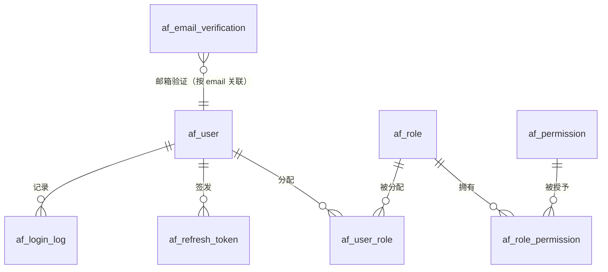

# 05 · 认证与权限设计（Authentication & RBAC）

> 版本：v0.1.0 ｜ 实现模块：`agentforge-security`（`agentforge-app` 负责装配）｜ 接口契约：[`04-API契约.md`](04-API契约.md) §2.1 ｜ 数据库：`V1__core_auth_rbac.sql`、`V2__token_audit_and_model.sql`

本文描述 AgentForge v0.1.0 **真实实现**的认证、会话与 RBAC 方案：包括数据模型、邮箱验证码、JWT 双 Token、登录风控、权限模型、SecurityFilterChain 装配、管理接口、配置项与扩展方式。文中所有路径、错误码、字段均与 [`04-API契约.md`](04-API契约.md) 及代码一致；契约是唯一事实来源，改接口必须先改契约。

## 1. 设计目标与边界

### 1.1 目标

- **无状态认证**：服务端不保存 HTTP Session，任意实例可处理任意请求（仅登出黑名单等进程内状态例外，见 §13）。
- **默认拒绝**：除白名单外所有接口都要求认证；所有写接口都要求对应权限码（`@PreAuthorize`）。
- **安全失败语义**：认证失败统一返回 `ApiResponse` JSON 与明确的业务错误码（40101/40102/…），不返回 HTML、空 body 或堆栈。
- **可降级**：无 Redis、无 SMTP 时仍可本地启动（内存实现 + 日志兜底），但生产环境必须按 [`SECURITY.md`](../SECURITY.md) 加固。
- **可扩展**：短信登录、第三方登录、Redis 化风控都预留扩展点，不破坏现有契约。
- **不泄漏信息**：登录统一提示"账号或密码错误"；忘记密码对不存在的邮箱也返回成功；日志不打印密码、Token 与验证码明文（开发兜底日志除外）。

### 1.2 非目标（v0.1.0 不提供）

| 能力 | 状态 |
| --- | --- |
| OAuth2 / SSO / 企业微信、GitHub 登录 | 未实现 |
| MFA（TOTP / WebAuthn） | 未实现 |
| 行级 / 部门级数据权限 | 未实现，当前只有功能权限 |
| 完整多租户隔离 | 仅保留 `tenant_id` 字段与 `TenantContext`，默认单租户 `1` |
| 短信登录 | 只有接口与扩展点，返回 `50300 sms-not-configured` |
| 撤销 access token 的分布式即时生效 | 进程内黑名单，多实例需 Redis（见 §13） |

## 2. 请求处理管线

```
HTTP 请求
  │
  ├─ TraceIdFilter（common，无 @Component，由 app 的 FilterConfig 注册为 Bean）
  │    读取或生成 X-Trace-Id（`[A-Za-z0-9._-]{1,64}`），写入 TraceContext + MDC
  │
  ├─ JwtAuthenticationFilter（security）
  │    有 Authorization: Bearer <access> 时：
  │      JwtService.parseAccessToken → 校验签名/type/exp/jti 黑名单
  │      → 构造 AuthenticatedUser 与 authorities（ROLE_<角色> + 权限码）
  │      → SecurityContextHolder.setAuthentication / UserContext / TenantContext
  │    解析失败时：只写 request attribute（40101 或 40100），不在这里写响应
  │
  ├─ AuthorizationFilter（Spring Security）
  │    白名单放行；未认证 → JsonAuthenticationEntryPoint（401 JSON）
  │    @PreAuthorize 不通过 → JsonAccessDeniedHandler（403 JSON）
  │
  ├─ Controller → Service → Repository（JPA / Flyway 管理的表）
  │
  └─ GlobalExceptionHandler：BizException、参数校验、404/405/409/500 → ApiResponse
     最后 finally 清理 UserContext / TenantContext / SecurityContextHolder
```

关键点：

- **TraceId 过滤器必须在最前面**：`app/config/FilterConfig.java` 用 `FilterRegistrationBean<TraceIdFilter>` 注册（common 的 `TraceIdFilter` 本身不是 Spring Bean），order `HIGHEST_PRECEDENCE`；否则响应里的 `traceId` 为空。
- **认证过滤器不直接写响应**：401 的响应格式由 `JsonAuthenticationEntryPoint` 统一输出，保证与 `GlobalExceptionHandler` 的 `ApiResponse` 结构一致；过期（40101）与无效（40100）的区分通过 request attribute 传递。
- **ThreadLocal 必须在 finally 清理**：`JwtAuthenticationFilter` 的 `finally` 中调用 `UserContext.clear()`、`TenantContext.clear()`、`SecurityContextHolder.clearContext()`，防止线程池复用导致身份串号。

## 3. 数据模型

### 3.1 实体关系



- **用户与角色**：多对多（`af_user_role`）。
- **角色与权限**：多对多（`af_role_permission`）。
- **权限码**：`resource:action` 形式（如 `user:read`），登录成功时随 access token 下发，方法级鉴权以 `hasAuthority('<code>')` 判断。
- **验证码、refresh、登录日志**：只追加/状态更新型表，不继承 `BaseEntity`，只有 `created_at`。

### 3.2 表结构

#### af_user（用户）

| 列 | 类型 | 约束 | 说明 |
| --- | --- | --- | --- |
| `id` | BIGINT | PK, 自增 | 主键 |
| `tenant_id` | BIGINT | NOT NULL DEFAULT 1 | 租户，`TenantContext.DEFAULT_TENANT_ID` |
| `username` | VARCHAR(64) | NOT NULL, UNIQUE `uk_af_user_username` | 登录名，`^[A-Za-z0-9_-]{3,32}$` |
| `email` | VARCHAR(128) | NOT NULL, UNIQUE `uk_af_user_email` | 归一化为小写存储 |
| `password_hash` | VARCHAR(128) | NOT NULL | BCrypt（强度 10） |
| `nickname` | VARCHAR(64) | NULL | 默认等于 username |
| `avatar_url` | VARCHAR(512) | NULL | 头像 |
| `phone` | VARCHAR(32) | NULL | 手机号（短信登录预留） |
| `status` | VARCHAR(16) | NOT NULL DEFAULT `ACTIVE` | `ACTIVE` / `DISABLED` / `LOCKED`（预留） |
| `email_verified` | BOOLEAN | NOT NULL DEFAULT FALSE | 注册/管理员创建均为 TRUE |
| `last_login_at` | DATETIME | NULL | 最近登录时间 |
| `created_at` / `updated_at` | DATETIME | NOT NULL | JPA `@PrePersist/@PreUpdate` 维护 |
| `version` | BIGINT | NOT NULL DEFAULT 0 | 乐观锁 |

#### af_role（角色）

| 列 | 类型 | 约束 | 说明 |
| --- | --- | --- | --- |
| `id` | BIGINT | PK, 自增 | |
| `tenant_id` | BIGINT | NOT NULL DEFAULT 1 | |
| `code` | VARCHAR(64) | NOT NULL | 唯一键 `(tenant_id, code)` |
| `name` | VARCHAR(64) | NOT NULL | 展示名 |
| `description` | VARCHAR(255) | NULL | |
| `builtin` | BOOLEAN | NOT NULL DEFAULT FALSE | 内置角色：不可删除、不可改权限 |
| `created_at` / `updated_at` | DATETIME | NOT NULL | |
| `version` | BIGINT | NOT NULL DEFAULT 0 | |

#### af_permission（权限）

| 列 | 类型 | 约束 | 说明 |
| --- | --- | --- | --- |
| `id` | BIGINT | PK, 自增 | |
| `code` | VARCHAR(128) | NOT NULL UNIQUE | 权限码，如 `role:write` |
| `name` | VARCHAR(64) | NOT NULL | 中文名 |
| `resource` | VARCHAR(64) | NOT NULL | 资源，如 `role` |
| `action` | VARCHAR(32) | NOT NULL | 动作，如 `read` |
| `description` | VARCHAR(255) | NULL | |
| `created_at` / `updated_at` | DATETIME | NOT NULL | |
| `version` | BIGINT | NOT NULL DEFAULT 0 | |

#### af_user_role / af_role_permission（关联表）

| 表 | 列 | 约束 |
| --- | --- | --- |
| `af_user_role` | `user_id`、`role_id` | 复合 PK，双外键（`af_user`、`af_role`），无审计字段 |
| `af_role_permission` | `role_id`、`permission_id` | 复合 PK，双外键（`af_role`、`af_permission`），无审计字段 |

#### af_email_verification（邮箱验证码）

| 列 | 类型 | 说明 |
| --- | --- | --- |
| `id` | BIGINT PK 自增 | |
| `email` | VARCHAR(128) | 归一化小写 |
| `code_hash` | VARCHAR(128) | `sha256(jwtSecret + "|email-code|" + email + "|" + scene + "|" + code)` 的十六进制 |
| `scene` | VARCHAR(32) | `REGISTER` / `LOGIN` / `RESET_PASSWORD` |
| `expires_at` | DATETIME | 签发时间 + 5 分钟 |
| `consumed` | BOOLEAN DEFAULT FALSE | 成功校验后置 TRUE；错误次数达到上限也置 TRUE |
| `attempts` | INT DEFAULT 0 | 错误次数 |
| `created_at` | DATETIME | 签发时间 |
| 索引 | `idx_af_email_code(email, scene, consumed)` | 查询最新一条未消费验证码 |

> 该表无 `updated_at/version`（验证码生命周期短，状态只有 `consumed/attempts`），因此对应实体不继承 `BaseEntity`，`created_at` 用 `@PrePersist` 维护。

#### af_refresh_token（刷新令牌）

| 列 | 类型 | 说明 |
| --- | --- | --- |
| `id` | BIGINT PK 自增 | |
| `user_id` | BIGINT | 所属用户，索引 `idx_af_refresh_user(user_id)` |
| `token_hash` | VARCHAR(128) NOT NULL UNIQUE | `sha256(jwtSecret + "|refresh|" + 明文)` |
| `expires_at` | DATETIME | 签发时间 + 7 天 |
| `revoked` | BOOLEAN DEFAULT FALSE | 轮换/登出/改密后置 TRUE |
| `user_agent` / `ip` | VARCHAR(255) / VARCHAR(64) | 签发时记录（可空） |
| `created_at` | DATETIME | |

> 只存哈希，**不存明文**；一次刷新即吊销旧行（一次性轮换），见 §4.4。

#### af_login_log（登录日志）

| 列 | 类型 | 说明 |
| --- | --- | --- |
| `id` | BIGINT PK 自增 | |
| `user_id` | BIGINT NULL | 登录失败且账号不存在时可为空 |
| `username` | VARCHAR(64) | 提交的登录名（邮箱/用户名） |
| `success` | BOOLEAN | 成功/失败 |
| `reason` | VARCHAR(255) NULL | 失败原因（`账号或密码错误`/`账号锁定`/`账号已禁用`/`邮箱未验证`；成功为 NULL，注册为`注册成功`） |
| `ip` / `user_agent` | VARCHAR(64) / VARCHAR(255) | 请求来源 |
| `created_at` | DATETIME | 索引 `idx_af_login_log_user(user_id, created_at)` |

登录日志通过 `GET /api/v1/login-logs` 只读查看（需 `audit:read`），由 `LoginLogService` 分页返回。

## 4. 认证流程

### 4.1 发送邮箱验证码

`POST /api/v1/auth/email-code`（匿名）

```json
{ "email": "alice@example.com", "scene": "REGISTER" }
```

处理顺序（`EmailCodeService#sendCode`）：

1. `email` 归一化（`trim` + 小写），`scene` 必须为 `REGISTER|LOGIN|RESET_PASSWORD`；
2. **60 秒冷却**：该邮箱 + 场景在 60 秒内已发过 → `40202`（HTTP 429），提示剩余秒数；
3. **单邮箱小时配额**：1 小时内该邮箱 + 场景达到 10 次 → `40202`；
4. **IP 维限流**：同一 IP 1 小时内超过 20 次 → `40202`（`InMemoryRateLimiter`，见 §6.7）；
5. 生成 6 位数字验证码（`SecureRandom`），落库哈希与有效期（5 分钟），`consumed=false`、`attempts=0`；
6. 通过 `MailSender` 发送；SMTP 未配置时 `RouterMailSender` 打印开发日志兜底；
7. 返回：

```json
{
  "code": 0,
  "data": { "email": "alice@example.com", "scene": "REGISTER",
            "expiresIn": 300, "cooldown": 60, "devCode": null }
}
```

`devCode` 仅在 `agentforge.auth.expose-code-in-response=true`（`AGENTFORGE_EXPOSE_CODE`）时返回，用于本地演示；生产必须为 `false`。

### 4.2 注册

`POST /api/v1/auth/register`（匿名）

```json
{ "email": "alice@example.com", "username": "alice", "password": "Passw0rd!", "code": "123456" }
```

1. 校验验证码（`scene=REGISTER`）：错误/过期/已用/错误次数超限 → `40201`（HTTP 400）；
2. 邮箱、用户名唯一性校验，冲突 → `40900`（message 分别为"该邮箱已被注册"/"该用户名已被占用"）；
3. 创建用户：`password_hash=BCrypt(password)`、`status=ACTIVE`、`email_verified=TRUE`（验证码已验证邮箱）、`tenant_id=1`、昵称缺省等于用户名；
4. 绑定默认角色 `USER`（内置角色缺失属服务端配置错误，返回 `50000`"默认角色 USER 未初始化，请检查 V1 迁移"）；
5. 写登录日志（`reason=注册成功`）、签发 access + refresh 返回（与登录相同的 `LoginResponse`）。

密码规则：8~64 位且至少含 1 个字母与 1 个数字（`^(?=.*[A-Za-z])(?=.*\d).{8,64}$`）。用户名：3~32 位字母/数字/下划线/短横线。

### 4.3 登录与失败锁定

`POST /api/v1/auth/login`（匿名）

```json
{ "account": "alice@example.com", "password": "Passw0rd!" }
```

- `account` 可以是邮箱或用户名：包含 `@` 按 `email` 查，否则按 `username` 查（邮箱已归一化小写）。
- 处理顺序（`AuthService#login`）：
  1. **锁定检查**：该账号（小写归一化）在锁定窗口内 → `40103`，message 含剩余秒数；
  2. 账号不存在或密码不匹配 → `LoginAttemptService.onFailure`，返回 `40100`"账号或密码错误"；
  3. 账号被禁用（`status != ACTIVE`）→ `40300`；
  4. 邮箱未验证（`email_verified=false`）→ `40104`（当前注册/管理员创建均为已验证，该分支为历史数据兜底）；
  5. 成功：清空失败计数、更新 `last_login_at`、写登录日志、签发 Token。
- **失败锁定**：同一账号（小写归一化）**连续失败 5 次即锁定 15 分钟**（失败计数在进程内累计，不要求 5 次都发生在 15 分钟内；锁定到期后计数清零）；锁定期间即使密码正确也返回 `40103`。成功登录立即清零。失败/成功都写 `af_login_log`：失败 reason 为"账号或密码错误"/"账号锁定"/"账号已禁用"/"邮箱未验证"，成功为 `null`（注册为"注册成功"）。

响应：

```json
{
  "code": 0,
  "data": {
    "accessToken": "<jwt>",
    "refreshToken": "<opaque-token>",
    "expiresIn": 7200,
    "user": { "id": 1, "username": "alice", "email": "alice@example.com",
              "nickname": "alice", "avatarUrl": null }
  }
}
```

`expiresIn` 单位秒（access token 有效期 7200s）。refresh token 只出现在响应体，不写入 Cookie。

### 4.4 Token 刷新与轮换

`POST /api/v1/auth/refresh`（匿名，凭 refresh token 本身鉴权）

```json
{ "refreshToken": "<opaque-token>" }
```

`RefreshTokenService#consume`：

1. 对明文做哈希后查 `af_refresh_token`；
2. 不存在 / 已 `revoked` / 已过期 → `40102`"refresh token 无效或已吊销"（HTTP 401）；
3. 命中则**立即将旧行置 `revoked=true`**，返回 `userId`；
4. 重新加载用户、校验状态，签发**新的 access + refresh**（轮换）。

因此 refresh token 是一次性的：旧 refresh 再次使用必然得到 `40102`。客户端遇到 40102 应清空本地会话并跳转登录页。

### 4.5 登出

`POST /api/v1/auth/logout`（需登录，`Authorization: Bearer <access>`；body 可选）

```json
{ "refreshToken": "<opaque-token>" }
```

- 解析当前 access token，把其 `jti` 写入内存黑名单（TTL 为 token 剩余有效期，过期自动清理）；
- body 带 refresh 时吊销该条；不带时**吊销该用户全部 refresh**（`revokeAll`）；
- 返回成功。之后旧 access 被判为已吊销 → `40100`；旧 refresh 再用 → `40102`。

### 4.6 当前用户与菜单

`GET /api/v1/auth/me`（需登录）

```json
{
  "code": 0,
  "data": {
    "user": { "id": 1, "username": "admin", "email": "admin@agentforge.dev",
              "nickname": "系统管理员", "avatarUrl": null },
    "roles": ["SUPER_ADMIN"],
    "permissions": ["agent:read", "role:write", "..."],
    "menus": [ { "code": "dashboard", "name": "概览", "path": "/dashboard" } ]
  }
}
```

与登录时 Token 里的快照不同，`/auth/me` **实时读数据库**（用户→角色→权限），用于刷新前端权限；若管理员刚调整了角色，重新调用即可生效（access token 中的旧权限直到过期前仍会参与后端鉴权，属于快照语义）。

菜单由权限推导（`AuthService#buildMenus`）：

| 所需权限 | 菜单 code | 名称 | 路径 |
| --- | --- | --- | --- |
| （始终） | `dashboard` | 概览 | `/dashboard` |
| `agent:read` | `agent` | Agent 管理 | `/agents` |
| `rag:read` | `rag` | 知识库 | `/knowledge` |
| `datasource:read` | `datasource` | 数据源 | `/datasources` |
| `model:read` | `model` | 模型配置 | `/models` |
| `memory:read` | `memory` | 记忆管理 | `/memory` |
| `audit:read` | `audit` | 审计日志 | `/audit` |
| `user:read` | `user` | 用户管理 | `/users` |
| `role:read` | `role` | 角色权限 | `/roles` |

### 4.7 忘记密码 / 重置密码

1. `POST /api/v1/auth/password/forgot`（匿名）`{ "email": "..." }`
   - 无论邮箱是否存在都返回成功（防账号枚举）；
   - 存在时下发 `scene=RESET_PASSWORD` 验证码，受 §6 的冷却与限流约束。
2. `POST /api/v1/auth/password/reset`（匿名）`{ "email", "code", "newPassword" }`
   - 校验验证码（`40201`）→ 更新 BCrypt 密码 → `revokeAll(userId)` 吊销该用户全部 refresh；
   - 已签发的 access token 在过期前仍有效（无状态 Token 的固有限制），前端应引导重新登录。

### 4.8 短信登录（预留扩展点）

`POST /api/v1/auth/sms-code`（匿名）`{ "phone": "13800001111" }`

- 当前固定返回 `50300`，message 含 `sms-not-configured: 短信登录通道尚未配置`；
- 扩展点已就绪：`SmsSender` 接口、`LoginChannel`（EMAIL/PHONE）、`PhoneLoginService`；接入真实通道后把 `agentforge.auth.sms-enabled` 置 `true` 并提供 `SmsSender` Bean 即可（见 §12.2）。

## 5. JWT 设计

### 5.1 算法与密钥

- 算法：**HS256**（HMAC-SHA256），密钥来自 `agentforge.auth.jwt-secret`（默认值仅供开发，生产用 `AGENTFORGE_JWT_SECRET` 覆盖）。
- 启动校验：密钥 UTF-8 编码后 **必须 ≥ 32 字节**，否则应用启动失败并提示用环境变量覆盖。
- 签名与解析统一由 `JwtService` 负责；密钥同时作为 refresh token 哈希与验证码哈希的 pepper（带固定前缀 `refresh` / `email-code` 做域分隔）。

### 5.2 access token claims

| claim | 值 | 说明 |
| --- | --- | --- |
| `sub` | userId | JWT 标准主体 |
| `username` | 用户名 | 便于日志/运维排查 |
| `tenantId` | 租户 ID | 过滤器写入 `TenantContext` |
| `roles` | 角色 code 数组 | 如 `["ADMIN"]` |
| `perms` | 权限码数组 | 如 `["user:read","rag:write"]`，`@PreAuthorize` 的 authority |
| `type` | `access` | 防止 refresh/access 混用 |
| `jti` | UUID | 登出黑名单键 |
| `iat` / `exp` | 签发/过期时间 | access TTL = 2h（`expiresIn=7200`） |

### 5.3 refresh token

- 值是 48 字节随机数的 Base64Url（无填充），**不是 JWT**；
- 服务端只存 `sha256(jwtSecret + "|refresh|" + 明文)`，TTL 7 天；
- 仅通过 `/auth/refresh` 与 `/auth/logout` 的请求体传输。

### 5.4 失效与错误映射

| 场景 | 响应 HTTP | code | 出口 |
| --- | --- | --- | --- |
| 未携带 Token 访问受保护接口 | 401 | 40100 | `JsonAuthenticationEntryPoint` |
| access 过期 | 401 | 40101 | 同上（区分提示刷新） |
| access 签名非法/格式错误 | 401 | 40100 | 同上 |
| access 已登出（jti 黑名单） | 401 | 40100 | 同上 |
| refresh 不存在/已吊销/过期 | 401 | 40102 | `BizException(40102)` → `GlobalExceptionHandler` |
| 已认证但权限不足 | 403 | 40300 | `JsonAccessDeniedHandler` / `AccessDeniedException` |
| 账号锁定 | 401 | 40103 | `BizException`（登录/刷新时） |

## 6. 验证码、限流与登录锁定

### 6.1 参数

| 参数 | 默认值 | 配置键 |
| --- | --- | --- |
| 有效期 | 5 分钟 | `agentforge.auth.email-code-ttl` |
| 长度 | 6 位数字 | `agentforge.auth.email-code-length` |
| 重发冷却 | 60 秒 | `agentforge.auth.email-code-cooldown` |
| 单邮箱小时上限 | 10 次 | `agentforge.auth.email-code-hourly-limit` |
| 单 IP 小时上限 | 20 次 | `agentforge.auth.email-code-ip-hourly-limit` |
| 错误次数上限 | 5 次 | `agentforge.auth.email-code-max-attempts` |
| 登录失败锁定 | 5 次 / 15 分钟 | `agentforge.auth.login-max-failures` / `login-lock-duration` |

### 6.2 存储与校验

- 哈希：`sha256(jwtSecret + "|email-code|" + email + "|" + scene + "|" + code)` 存十六进制，**数据库不含验证码明文**；
- 校验取该 `(email, scene)` 下最新一条未消费记录；过期、已消费、`attempts >= 5` 均返回 `40201`；
- 使用 `MessageDigest.isEqual` 常量时间比较，避免时序侧信道；
- 匹配成功置 `consumed=true`；失败 `attempts++`，达到上限时一并置 `consumed=true`（需重新获取验证码）。

### 6.3 发送频控顺序

```
冷却(60s) → 单邮箱 1h 配额(10) → 单 IP 1h 配额(20) → 落库 → 发送
```

限流键：`email-code:ip:<ip>`；IP 取自请求（开发/网关场景注意信任代理头的配置）。

### 6.4 开发环境验证码可见性

- `agentforge.auth.mail-enabled=false`（默认）：`RouterMailSender` 不发送邮件，改用日志输出
  `[DEV-MAIL] 邮箱验证码 email=... scene=... code=... (SMTP 未启用，仅开发环境可见)`；
- `agentforge.auth.expose-code-in-response=true`：响应体 `devCode` 直接返回验证码，用于自动化演示/冒烟测试；
- 两者都只允许在本地/CI 使用，生产必须关闭（见 [`SECURITY.md`](../SECURITY.md) §4）。

### 6.5 登录锁定

- 键：登录名归一化（`trim` + 小写）后的 `account`；
- 连续失败达到 `login-max-failures` 次后锁定 `login-lock-duration`，期间返回 `40103` 并提示剩余秒数；
- 锁定到期后失败计数清零；成功登录清零；锁定状态在进程内（`LoginAttemptService`），多实例部署需 Redis 化。

### 6.6 验证码与登录的关系

- 注册必须验证 `REGISTER` 场景验证码；
- 登录默认**不需要**验证码（邮箱 + 密码即可），`LOGIN` 场景预留用于后续"异地登录二次验证"；
- 重置密码必须验证 `RESET_PASSWORD` 场景验证码。

### 6.7 进程内安全状态清单

| 组件 | 作用 | 多实例问题 | 演进方式 |
| --- | --- | --- | --- |
| `TokenBlacklist` | access token `jti` 黑名单 | 登出不跨节点生效 | Redis + TTL |
| `LoginAttemptService` | 登录失败计数/锁定 | 锁定不跨节点生效 | Redis 计数器 + 过期时间 |
| `InMemoryRateLimiter` | 验证码 IP 限流 | 各节点独立计数 | Redis 滑动窗口/网关限流 |

三者都是小接口/单一职责类，替换时保持调用方不变即可。

## 7. RBAC 权限模型

### 7.1 模型

```
用户 (af_user) ──< af_user_role >── 角色 (af_role) ──< af_role_permission >── 权限 (af_permission)
```

- 一个用户可拥有多个角色，权限为所有角色权限的并集；
- 权限码格式 `resource:action`，全小写，动作为 `read|write|run|query`；
- 后端以 `@PreAuthorize("hasAuthority('<permission>')")` 做方法级鉴权；无权限统一 403 + `40300`。

### 7.2 权限码全集（17 个）

| 权限码 | 资源 | 动作 | 说明 |
| --- | --- | --- | --- |
| `user:read` | user | read | 查看用户列表/详情 |
| `user:write` | user | write | 创建、编辑、禁用、重置密码 |
| `role:read` | role | read | 查看角色与权限树 |
| `role:write` | role | write | 角色 CRUD、分配权限 |
| `audit:read` | audit | read | 审计日志、Token 用量、登录日志 |
| `model:read` | model | read | 查看模型配置与用量 |
| `model:write` | model | write | 模型配置增删改、测试连接 |
| `agent:read` | agent | read | 查看 Agent/版本/运行记录 |
| `agent:write` | agent | write | Agent/版本/编排增删改 |
| `agent:run` | agent | run | 发起对话与运行 Agent |
| `rag:read` | rag | read | 查看知识库/文档/分块 |
| `rag:write` | rag | write | 知识库 CRUD、上传/删除文档 |
| `datasource:read` | datasource | read | 查看数据源/Schema/查询日志 |
| `datasource:write` | datasource | write | 数据源 CRUD、连接测试、沙箱执行 |
| `datasource:query` | datasource | query | 执行只读 SQL |
| `memory:read` | memory | read | 查看记忆 |
| `memory:write` | memory | write | 写入/删除记忆 |

> 前 15 个由 V1 迁移种子，`model:read` / `model:write` 由 V2 迁移补充。

### 7.3 内置角色与权限矩阵

| 权限码 | SUPER_ADMIN | ADMIN | USER |
| --- | :---: | :---: | :---: |
| `user:read` | ✅ | ✅ | ❌ |
| `user:write` | ✅ | ❌ | ❌ |
| `role:read` | ✅ | ✅ | ❌ |
| `role:write` | ✅ | ❌ | ❌ |
| `audit:read` | ✅ | ✅ | ❌ |
| `model:read` | ✅ | ✅ | ❌ |
| `model:write` | ✅ | ❌ | ❌ |
| `agent:read` | ✅ | ✅ | ✅ |
| `agent:write` | ✅ | ✅ | ❌ |
| `agent:run` | ✅ | ✅ | ✅ |
| `rag:read` | ✅ | ✅ | ✅ |
| `rag:write` | ✅ | ✅ | ❌ |
| `datasource:read` | ✅ | ✅ | ✅ |
| `datasource:write` | ✅ | ✅ | ❌ |
| `datasource:query` | ✅ | ✅ | ✅ |
| `memory:read` | ✅ | ✅ | ✅ |
| `memory:write` | ✅ | ✅ | ❌ |
| **合计** | **17** | **14** | **6** |

- 内置角色 `builtin=true`：**不可删除**；`PUT /roles/{id}` 请求体中**只要携带 `permissionIds`（即使与现有权限相同）就返回 `40000`**，权限不允许修改；名称/描述可改。
- 自定义角色：可自由分配权限，但删除前必须无关联用户（否则 `40900`）；分配权限时包含不存在的 `permissionId` → `40000 "包含不存在的权限 id"`。

### 7.4 权限来源与快照语义

| 场景 | 权限来源 |
| --- | --- |
| 登录 / 刷新签发 access token | 实时查库，写入 `perms` claim |
| 每次请求鉴权 | access token 中的 `perms`（`@PreAuthorize`） |
| `/auth/me`、前端菜单 | 实时查库 |

因此管理员修改角色权限后：新登录立即生效；已登录用户继续使用旧 access token 到过期（≤2h），刷新或重新登录后更新。

## 8. SecurityFilterChain 装配

### 8.1 白名单

| 路径 | 说明 |
| --- | --- |
| `OPTIONS /**` | CORS 预检 |
| `/api/v1/auth/email-code` | 发送验证码 |
| `/api/v1/auth/register` | 注册 |
| `/api/v1/auth/login` | 登录 |
| `/api/v1/auth/refresh` | 刷新（凭 refresh 本身） |
| `/api/v1/auth/password/**` | 忘记/重置密码 |
| `/api/v1/auth/sms-code` | 短信验证码（返回 50300） |
| `/actuator/health`、`/actuator/health/**`、`/actuator/info` | 健康检查/信息 |
| `/swagger-ui.html`、`/swagger-ui/**`、`/v3/api-docs`、`/v3/api-docs/**` | 接口文档 |
| `/error` | 错误转发 |
| `/h2-console/**` | **仅 dev profile** 放行 |

其余全部 `authenticated()`；`/auth/me`、`/auth/logout` 均需登录。

### 8.2 其他配置

| 项 | 值 | 原因 |
| --- | --- | --- |
| CSRF | 关闭 | 纯 Bearer Token、无 Cookie 会话 |
| Session | `STATELESS` | 无状态认证 |
| CORS | `Customizer.withDefaults()`（可用 `CorsConfigurationSource` 覆盖） | 前后端分离 |
| `frameOptions` | `sameOrigin` | 允许 dev H2 Console |
| dispatcher types | `ASYNC`、`ERROR` 放行 | SSE/DeferredResult 二次分派时 SecurityContext 不传播，避免误判 403 并中断流 |
| 默认用户 | 启动类排除 `UserDetailsServiceAutoConfiguration` | 防止 Spring Security 生成内存默认用户，认证完全由自研 JWT 过滤器承担 |
| 密码编码器 | `BCryptPasswordEncoder(10)` | BCrypt 强度 10，满足 §4.2 要求 |

### 8.3 401 / 403 响应

所有认证/授权失败均返回 `ApiResponse`：

```json
{
  "code": 40100,
  "message": "未登录或登录已过期",
  "data": null,
  "traceId": "b7c3...",
  "timestamp": "2026-10-29T12:00:00Z"
}
```

- 未携带 Token：40100，message "未登录或登录已过期"；
- Token 非法/签名错误/已登出：40100，message "access token 无效，请重新登录"；
- 过期 access：40101，message "access token 已过期，请使用 refresh token 刷新"；
- 无权限返回 403 + 40300（"没有权限执行该操作"），不暴露所需权限码；
- `GlobalExceptionHandler` 对 `BizException` 按业务码映射 HTTP 状态：401xx→401、403xx→403、404xx→404、409xx→409、42900/40202→429、50000→500、其余 ≥50000→503、其他 4xxxx（含 40201）→400。

## 9. 管理接口与权限码

| 方法 | 路径 | 权限码 | 说明 |
| --- | --- | --- | --- |
| GET | `/api/v1/users` | `user:read` | 分页（`page` 从 1、`size≤100`）、`keyword`、`status` |
| GET | `/api/v1/users/{id}` | `user:read` | 用户详情 |
| POST | `/api/v1/users` | `user:write` | 创建用户（可直接分配角色，邮箱默认已验证） |
| PUT | `/api/v1/users/{id}` | `user:write` | 改昵称/状态/角色 |
| DELETE | `/api/v1/users/{id}` | `user:write` | 软禁用（`status=DISABLED`） |
| PUT | `/api/v1/users/{id}/password` | `user:write` | 管理员重置密码（并吊销其 refresh） |
| GET | `/api/v1/roles` | `role:read` | 角色列表（含 permissionIds） |
| POST | `/api/v1/roles` | `role:write` | 创建自定义角色 |
| PUT | `/api/v1/roles/{id}` | `role:write` | 改名称/描述/权限（内置角色不可改权限） |
| DELETE | `/api/v1/roles/{id}` | `role:write` | 删除自定义角色（内置不可删、使用中 409） |
| GET | `/api/v1/permissions` | `role:read` | 权限树（按 resource 分组） |
| GET | `/api/v1/login-logs` | `audit:read` | 登录日志分页 |

管理规则补充：

- 不能禁用当前登录账号（`40000 "不能禁用当前登录账号"`）；
- `status` 只接受 `ACTIVE` / `DISABLED`；
- 分配角色为**覆盖式**：传入空数组 → 回到默认 `USER` 角色；包含不存在的角色 ID → `40000`；
- 角色 code 规则 `^[A-Z][A-Z0-9_]{1,31}$`，租户内唯一，冲突 `40900`。

## 10. 配置项

`agentforge.auth.*`（`AuthProperties`，可被环境变量/命令行覆盖）：

| 配置键 | 默认值 | 环境变量/说明 |
| --- | --- | --- |
| `jwt-secret` | dev 占位值（≥32 字节） | `AGENTFORGE_JWT_SECRET`，**生产必须替换** |
| `access-token-ttl` | `2h` | access 有效期 |
| `refresh-token-ttl` | `7d` | refresh 有效期 |
| `email-code-ttl` | `5m` | 验证码有效期 |
| `email-code-length` | `6` | 验证码位数 |
| `email-code-max-attempts` | `5` | 错误次数上限 |
| `email-code-cooldown` | `60s` | 重发冷却 |
| `email-code-hourly-limit` | `10` | 单邮箱 1h 上限 |
| `email-code-ip-hourly-limit` | `20` | 单 IP 1h 上限 |
| `login-max-failures` | `5` | 连续失败锁定阈值 |
| `login-lock-duration` | `15m` | 锁定时长 |
| `mail-enabled` | `false` | `AGENTFORGE_MAIL_ENABLED`，true 时走 SMTP，否则日志兜底 |
| `sms-enabled` | `false` | 短信登录开关（预留） |
| `expose-code-in-response` | `false` | `AGENTFORGE_EXPOSE_CODE`，仅开发 |
| `seed-admin-enabled` | `true` | `AGENTFORGE_SEED_ADMIN`，仅 dev 生效，见 §11 |
| `seed-admin-email` | `admin@agentforge.dev` | 种子管理员邮箱 |
| `seed-admin-username` | `admin` | 种子管理员用户名 |
| `seed-admin-password` | Java 字段默认空串（**为空则跳过种子**）；`application.yml` 为 `${AGENTFORGE_ADMIN_PASSWORD:Admin@123456}` | 种子管理员密码 |
| `seed-admin-nickname` | `系统管理员` | |

SMTP 需同时配置 `spring.mail.host/port/username/password/default-encoding`（`application.yml` 中为注释示例），并设置 `mail-enabled=true`。

生产 profile `application-prod.yml` 额外覆盖：`seed-admin-enabled=false`、`expose-code-in-response=false`、`mail-enabled` 默认 `true`、`memory.redis-enabled` 默认 `true`；数据库与密钥通过环境变量注入，见 [`SECURITY.md`](../SECURITY.md) §4。

## 11. 开发环境种子管理员

- 位置：`agentforge-app/src/main/java/com/agentforge/app/config/DataInitializer.java`，`@Profile("dev")` + `ApplicationRunner`；
- 创建条件（全部满足）：`seed-admin-enabled=true`、`seed-admin-password` 非空、该邮箱不存在、`SUPER_ADMIN` 角色存在；
- 创建内容：`admin@agentforge.dev` / `Admin@123456`（yml 默认，可被 `AGENTFORGE_ADMIN_PASSWORD` 覆盖）、`email_verified=true`、`status=ACTIVE`、绑定 `SUPER_ADMIN`；
- **不写入 Flyway**（迁移只建表与内置角色/权限），避免生产库出现默认弱口令账号；
- 日志只打印 `dev 管理员已创建 email=... username=... roles=[SUPER_ADMIN]`，**不打印密码**。

## 12. 扩展指南

### 12.1 新增权限码

1. 新增 Flyway 迁移（下一个编号，见 [`04-API契约.md`](04-API契约.md) §5）：`insert into af_permission(...) values (...)`，并 `insert into af_role_permission` 授权给需要的内置角色；
2. Controller 方法标注 `@PreAuthorize("hasAuthority('new:code')")`；
3. 如需展示，在 `AuthService#buildMenus` 增加菜单映射；
4. 前端权限指令/路由守卫使用同一权限码；
5. 补集成测试（有权限 200、无权限 403）。

### 12.2 接入短信登录

1. 实现 `SmsSender#sendLoginCode(String phone)`（阿里云/腾讯云短信 SDK），注册为 `@Component`，替换默认 `UnsupportedSmsSender`；
2. 配置 `agentforge.auth.sms-enabled=true`；
3. 在 `PhoneLoginService#loginByPhone` 中补"验证码校验 + 查/建用户 + 签发 Token"逻辑（当前抛 `50300`）；
4. 保持 `/auth/sms-code` 的响应契约不变（成功后返回与邮箱验证码一致的结构），并补迁移存储短信验证码（或复用 `af_email_verification` 扩展 `phone` 维度）。

### 12.3 将进程内状态迁移到 Redis

`TokenBlacklist`、`LoginAttemptService`、`InMemoryRateLimiter` 都是独立类，替换为 Redis 实现时保持方法签名不变：黑名单用 `SETEX jti:...`、失败计数用 `INCR + EXPIRE`、限流用滑动窗口或令牌桶。Redis 不可用时按 AGENTS.md 要求自动降级回内存实现，不能阻塞启动。

### 12.4 新增登录渠道

`LoginChannel` 枚举（EMAIL/PHONE）+ 各渠道 Service 组合；统一由 `/auth/*` 控制器暴露，Token 签发复用 `JwtService + RefreshTokenService`，确保 `AuthService#issueTokens` 是唯一签发入口。

## 13. 已知限制

1. **access token 撤销非全局即时**：登出黑名单在进程内，多实例部署时其他节点仍可能接受已登出的 access token（直到过期 ≤2h）；敏感操作建议短 TTL 或引入 Redis 黑名单。
2. **权限快照**：access token 内的权限在有效期内不会随角色变更实时更新（`/auth/me` 已实时，但鉴权用快照）。
3. **无 MFA**；密码策略仅长度 + 字母数字，未做弱口令库校验。
4. **IP 来源信任**：限流取直接请求 IP，部署在反向代理后需正确配置可信代理头，否则所有请求会被视为同一 IP。
5. **refresh token 清理**：轮换/吊销只置 `revoked=true`，暂无过期行清理任务。
6. **数据权限缺失**：所有 `user:read` 持有者可查看全租户用户；行级权限需后续设计。
7. **短信登录、SSO、多租户隔离**未实现（见 §1.2）。

## 14. 测试与验证

| 层次 | 内容 | 命令 |
| --- | --- | --- |
| 单元测试 | `JwtServiceTest`（签发/解析/篡改/type/黑名单）、`LoginAttemptServiceTest`（阈值/锁定/清零）、`InMemoryRateLimiterTest`（窗口/重置）、`EmailCodeServiceTest`（冷却/校验/错误次数） | `mvn -pl agentforge-security test` |
| 集成测试 | `AuthFlowIntegrationTest`（MockMvc + H2 内存库）：验证码→注册→登录→me→刷新轮换→旧 refresh 40102→401/403→sms-code 50300→登出后旧 access 40100 | `mvn -pl agentforge-app test -Dtest=AuthFlowIntegrationTest` |
| 端到端冒烟 | `scripts/smoke-test.mjs` / `smoke-test.ps1`：dev 环境真实 HTTP，覆盖 `/auth/*`、用户/角色/权限、登录日志、限流 | `node scripts/smoke-test.mjs --base-url http://127.0.0.1:8080` |

> JDK 21 + Mockito 需允许动态 attach：`JAVA_TOOL_OPTIONS='-Djdk.attach.allowAttachSelf=true -XX:+EnableDynamicAgentLoading'`（security 模块 surefire 已配置，app 模块测试时通过环境变量传入）。

## 15. 相关文档

- 接口契约：[`04-API契约.md`](04-API契约.md)（§2.1 认证、§2.2 用户/角色/权限、附录 A 权限码、附录 B 业务错误码）
- 技术方案：[`01-技术方案.md`](01-技术方案.md) §4 认证与权限、§7 安全
- 开发环境：[`03-本地开发环境.md`](03-本地开发环境.md)（dev profile、默认账号、验证码日志）
- 安全策略与部署红线：[`SECURITY.md`](../SECURITY.md)
- 贡献指南：[`CONTRIBUTING.md`](../CONTRIBUTING.md)
